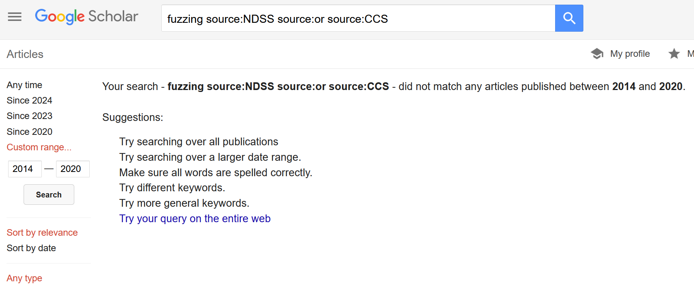

<h2 align="center">
  
</h2>
<h1 align="center"><a href="https://cspapers.org" target="_blank">cspapers.org</a></h1>
<h4 align="center">Rapid search engine for Computer Science papers</h4>

<p align="center">
  <a href="https://github.com/swkim101/cspapers.org/actions">
    
  </a>
</p>

---

## Why not Google Scholar

Poor conference filter:



¯\\_(ツ)_/¯

## Tips
1. Use __"double quote"__ for exact matching
2. API is open. Curl and NodeJS work:
```bash
$ curl 'https://api.cspapers.org/?query=bluetooth&yearFrom=2019&yearTo=2025&venue=NDSS%2CUsenix%2CSP%2CCCS&orderBy=score&ascending=false&skip=0'
```
```js
const q = {
  query:     "bluetooth fuzzing",
  orderBy:   "score",
  ascending: false,
  venue:     ["Usenix", "SP"],
  yearFrom:  2024,
  yearTo:    2025,
  skip:      0,
  must: ["bluetooth"]
}
const qs = new URLSearchParams(q)
fetch(`https://api.cspapers.org/?${qs}`)
.then(async (res) => {
  console.log(await res.json());
})
```


To retrieve an abstract, use the search result's `index` value as the paper ID.

```
GET https://api.cspapers.org/abstracts/{index}
```

The endpoint returns UTF-8 text with HTTP 200, HTTP 204 when the paper has no abstract, and HTTP 404 for an unknown paper ID.

## Run locally

Place the Semantic Scholar export `2026-11-17-selected-venues.jsonl.gz` in the repository root. Each line contains a paper's `title`, `year`, `venue_label`, `doi`, and `abstract`. The indexer reads the whole gzip file in batches and stores the title, year, venue, and available abstract in one Bleve DB.

```bash
make -B lemmas
make index
go run ./api.cspapers.org/server/ -config full.server.config
```

`make index` reads `default.index.config` and creates `data/bleve-2026-11-17/`. Reuse the completed DB if it already exists. To rebuild while retaining it, choose an unused output path and point the server configuration at the new DB.

In another terminal, run `npm ci` and `npm run dev`. The frontend uses `VITE_API_HOST` for both search and abstract requests. Local development defaults to `http://localhost:8000`.

To check the API, run a search and copy an `index` value from the results into the second command.

```bash
curl -fsS 'http://localhost:8000/?query=SoundBubble&yearFrom=2026&yearTo=2026&venue=CHI&orderBy=score&ascending=false&skip=0'
curl -fsS 'http://localhost:8000/abstracts/PAPER_ID'
```

## Deploy

Run the following commands from the repository root after building or reusing the full Bleve DB.

```bash
make -B lemmas
GOARCH=amd64 make -B server
fly deploy --remote-only
```

The Dockerfile packages the host-built Linux server, lemma files, and full Bleve DB. Fly's remote builder assembles the runtime image and starts the API on port 8000 with `full.server.config`. Deploy from a checkout that contains the generated files so Fly can include them in the build context. [Fly deploy reference](https://docs.fly.io/flyctl/cmd/fly_deploy)

When changing the dataset release, update the input and DB paths in `default.index.config` and keep the DB path in `full.server.config`, `Dockerfile`, and `.dockerignore` in sync.

Run `npm run build` to regenerate the frontend under `docs/` for GitHub Pages. Release the frontend and the API together so the site's abstract requests use the new endpoint.

## Research

If you need any help, feel free to contact me at iam@sungwoo-kim.  

* [USENIX'25] [SoK: Towards Effective Automated Vulnerability Repair](https://www.usenix.org/system/files/usenixsecurity25-li-ying.pdf)

## Acknowlegement

- I referred to csrankings.org for organizing conferences.
- Thanks to https://github.com/michmech/lemmatization-lists for lemma data.
- All data is from to Semantic Schoalr, so consider citing Semantic Scholar:
```
@misc{https://doi.org/10.48550/arxiv.2301.10140,
 title = {The Semantic Scholar Open Data Platform},
 author = {Kinney, Rodney and Anastasiades, Chloe and Authur, Russell and Beltagy, Iz and Bragg, Jonathan and Buraczynski, Alexandra and Cachola, Isabel and Candra, Stefan and Chandrasekhar, Yoganand and Cohan, Arman and Crawford, Miles and Downey, Doug and Dunkelberger, Jason and Etzioni, Oren and Evans, Rob and Feldman, Sergey and Gorney, Joseph and Graham, David and Hu, Fangzhou and Huff, Regan and King, Daniel and Kohlmeier, Sebastian and Kuehl, Bailey and Langan, Michael and Lin, Daniel and Liu, Haokun and Lo, Kyle and Lochner, Jaron and MacMillan, Kelsey and Murray, Tyler and Newell, Chris and Rao, Smita and Rohatgi, Shaurya and Sayre, Paul and Shen, Zejiang and Singh, Amanpreet and Soldaini, Luca and Subramanian, Shivashankar and Tanaka, Amber and Wade, Alex D. and Wagner, Linda and Wang, Lucy Lu and Wilhelm, Chris and Wu, Caroline and Yang, Jiangjiang and Zamarron, Angele and Van Zuylen, Madeleine and Weld, Daniel S.},
 publisher = {arXiv},
 year = {2023},
 doi = {10.48550/ARXIV.2301.10140},
 url = {https://arxiv.org/abs/2301.10140},
 }
```

## Disclaimer

- cspapers.org indexes titles and abstracts. Paper contents and authors are ***not*** indexed.  
- All data is from Semantic Scholar Dataset: https://api.semanticscholar.org/api-docs/datasets.  
- cspapers.org is served as implemented as is in this repository. I do not modify source code or data in and after distributions.  
- cspapers.org uses cloudflare for caching and fly.io for serving.  
- cspapers.org does not collect user data, such as search history and IP address. However, Cloudflare and fly.io may do this for pricing and security purposes.
